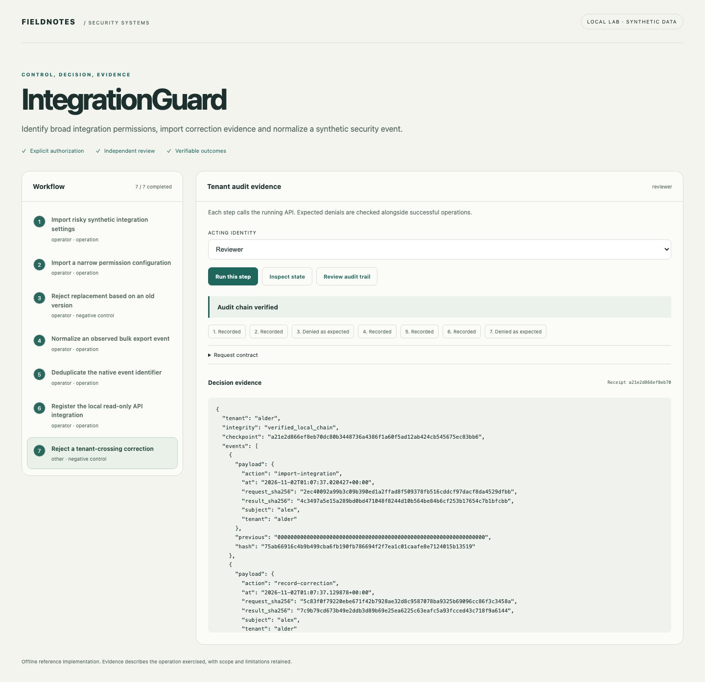
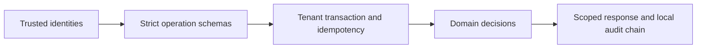

# IntegrationGuard

[](https://github.com/jayekwere/integrationguard/actions/workflows/verify.yml) [MIT](LICENSE)

**Enterprise integration findings with exact source fields and real local HTTP evidence.**

Import integration observations, identify broad scopes and missing safeguards, retain correction history, deduplicate native event identifiers, exercise a restricted HTTP gateway and deliver signed events to a local durable receiver.



## Run locally

Python 3.14 and Node 24 through 26. Initial dependency installation requires network access. All core demonstrations run offline after setup. Each repository is independent and ships its own lockfiles.

```sh
git clone https://github.com/jayekwere/integrationguard.git
cd integrationguard
python3 -m venv .venv
. .venv/bin/activate
python -m pip install --require-hashes -r requirements-dev.lock
npm ci --ignore-scripts
npm run build
python -m app.cli demo
python -m app.cli serve --demo
```

Open [the local workbench](http://127.0.0.1:8080). Run steps in order. The acting identity and expected denial are visible before each operation. Each step submits a real API request, and results are rendered as text. Demo credentials are public synthetic fixtures. Use them only on the private local lab.

The CLI uses temporary state and leaves the served workbench independent. The server persists its synthetic state in `artifacts/state.db`; select a new `STATE_PATH` for a fresh exercise. CLI records use a fixed observation clock where possible. The committed sample output is generated from the executable scenario, not hand-authored findings.

```sh
docker compose up --build
# Stop and discard the temporary container workspace:
docker compose down
```

Compose publishes only to loopback. It uses a non-root UID, read-only root filesystem, dropped capabilities, a private temporary state area, a memory limit and a process limit. Temporary container state is discarded when the container is removed.

## Evidence and implementation

Observations retain source identity, timestamp, digest, previous snapshot digest and explicit unknown settings. Findings point to exact normalized fields. Corrections require the current record version and fresh replacement evidence; they do not write to the provider. Event deduplication binds native identifier, integration and event content and rejects conflicting reuse. The local gateway permits one synthetic count resource, a server-owned loopback destination and exactly synthetic:read scope. It disables environment proxies and redirects, bounds replies, records successful read evidence and limits an identity to five requests per minute. A separate executable local receiver verifies a domain-separated HMAC, deduplicates delivery content and independently reads back its persisted receipt.



The shared architecture pattern is small Python FastAPI domain services with SQLite transactions and a TypeScript workbench. The domain logic is specific to this project. JSON input contracts reject unknown fields and type coercion. SQL is parameterized for tenant data. All state changes and successful operation receipts commit together. Replay keys bind actor, roles, action and payload. Audit events retain digests rather than request contents. Local chains detect accidental edits; a database writer can recompute a chain, so an independent checkpoint is necessary for stronger tamper evidence.

## Verify

```sh
npm run verify
python -m ruff check app tests
python -m ruff format --check app tests
python -m mypy app
python -m pytest
npx playwright install chromium
npm run test:browser
docker build -t integrationguard:local .
node scripts/container-smoke.mjs integrationguard:local
```

Browser tests require fresh `artifacts/browser-state.db` state. See [verification evidence](docs/verification.md), [architecture](docs/architecture.md), [threat model](docs/threat-model.md), [security design](docs/security-design.md), [API](docs/api.md) and [schemas](schemas/contracts.json). Hosted CI enforces at least 80% Python statement/branch coverage and runs browser, dependency, exact-fixture or semantic-demo, and restricted-container checks. Coverage describes executed code and is not a security score.

## Optional native reads

Only run collectors against explicitly authorized resources. Exports are written exclusively to private local files and must be reviewed before sharing. Native reads are separate from the offline scenario.

```sh
python -m app.salesforce --instance https://YOUR_ORG.my.salesforce.com --credential-file /private/path/salesforce.json --output artifacts/salesforce-export.json
```

## Limits

No Salesforce or Vanta account was available for native acceptance. Salesforce collector contract tests use synthetic HTTP responses; they are not account verification. Its native query covers PermissionSet definitions only, not assignments, muting, MFA, connected applications or proven effective permissions. OAuth scopes in the assessment come from explicit imported observations. There is no native MuleSoft connector. The gateway and event receiver are actual loopback services using synthetic data, not live enterprise integrations. The receiver is not a commercial SIEM. Provider corrections are proposed by evidence only, never automatically executed. Rate windows are process-local.

The service is a bounded single-node reference implementation. It supports at most 200 records per kind and 5,000 successful audit events per tenant before requiring a new workspace or deliberate archival work. Bearer identities are server-configured; there is no external identity provider, distributed scheduler, managed key service or production deployment. The offline browser interface is available only in explicit demo mode. Configured API mode requires a private identity file, accepts no demo tokens and remains intended for local evaluation. No security certification or exhaustive vulnerability guarantee is claimed.

See [SECURITY.md](SECURITY.md) and [CONTRIBUTING.md](CONTRIBUTING.md).

Immutable observation snapshots retain correction history. A correction links to its previous digest and stores replacement source evidence before updating the current view. The offline CLI additionally sends normalized events over actual loopback HTTP to a signed, durable local receiver and checks signature rejection, delivery replay and independent persisted readback.
